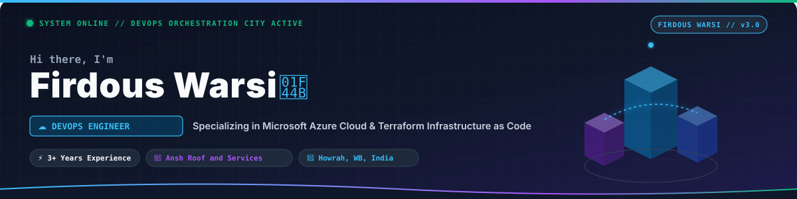
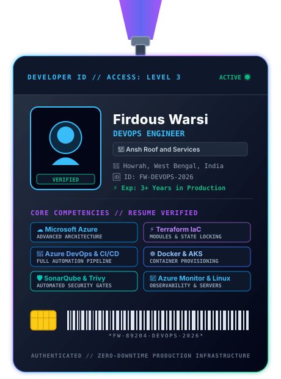
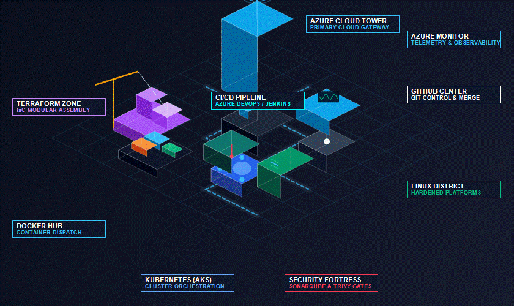
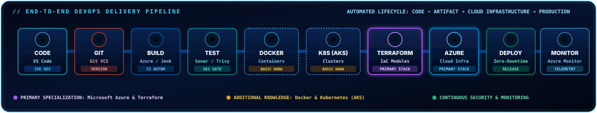
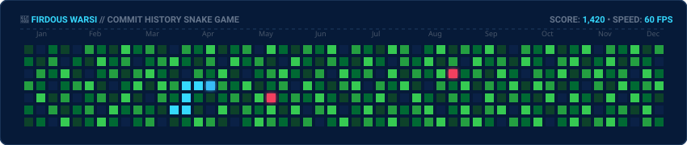

<table>
<tr>
<td width="34%" valign="top">

 

 

**MY DEVOPS UNIVERSE**

📍 Bengaluru, India

</td>
<td width="66%" valign="middle">

# Hi, I'm Firdous Warsi 👋

### DevOps Engineer | Cloud & Automation

I enjoy building reliable cloud infrastructure, automating workflows and exploring modern DevOps technologies.

**My focus areas**

- Microsoft Azure
- Infrastructure as Code with Terraform
- Azure DevOps and CI/CD
- Git and GitHub
- Cloud infrastructure automation

Docker and Kubernetes — Basic Knowledge.

</td>
</tr>
</table>

---

## ◈ ABOUT ME

<table>
<tr>
<td width="50%" valign="top">

### ☁️ Cloud & Infrastructure

Working with Microsoft Azure to understand, provision and manage cloud infrastructure.

### ⚙️ Infrastructure as Code

Using Terraform modules, variables, reusable configurations and remote state.

</td>
<td width="50%" valign="top">

### 🔄 Automation & CI/CD

Building automated deployment workflows using Azure DevOps YAML pipelines and Git.

### 🔐 DevSecOps Practices

Exploring infrastructure security scanning, code quality and secret detection.

</td>
</tr>
</table>

## ◈ TECHNOLOGY ORBIT

### My Technology Stack

| Category | Technologies |
|---|---|
| Cloud | Microsoft Azure |
| Infrastructure as Code | Terraform |
| CI/CD | Azure DevOps |
| Version Control | Git, GitHub |
| Containers | Docker — Basic |
| Orchestration | Kubernetes — Basic |
| Operating System | Linux |
| Security | Checkov, TFSec, SonarQube |
| Scripting | Bash, YAML |

---

## ◈ DEVOPS DELIVERY PIPELINE

My typical infrastructure delivery workflow:

`Git Commit` → `Pull Request` → `Validation` → `Security Scan` → `Terraform Plan` → `Approval` → `Terraform Apply` → `Deployment`

---

## ◈ FEATURED BUILDS

### 🌆 Interactive DevOps City

An interactive digital DevOps environment showcasing cloud infrastructure, automation and modern DevOps technologies.

**Built with:** HTML, CSS, JavaScript and hand-tracking interaction.

[Explore the DevOps City source](references/devops_city_gesture_interface.html)

---

## ◈ GITHUB TELEMETRY

 

 

---

## ◈ LET'S CONNECT

**Interested in Cloud, DevOps, Infrastructure Automation and Technology.**

  

*Building. Automating. Learning. Improving.*

**Firdous Warsi | DevOps Engineer**

📍 Bengaluru, India

